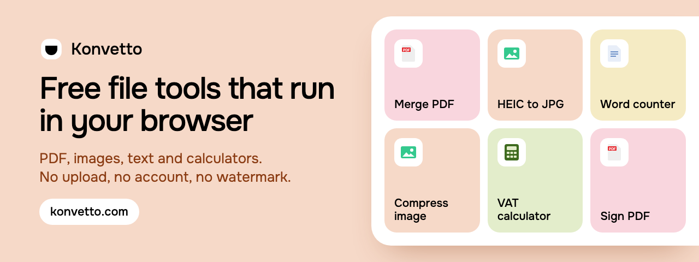

  <a href="https://konvetto.com"><b>konvetto.com</b></a> · English, Polski, Deutsch, Español, Français

---

Most online converters send your file to a server, process it there and delete it later. Konvetto
does the work inside the browser tab: the file is read, changed and saved on your own device. You
can [check it yourself](https://konvetto.com/how-it-works) in your browser's Network tab.

### Open source

| Project | What it does |
| --- | --- |
| [**pngmint**](https://github.com/konvetto/pngmint) | Palette PNG quantizer in TypeScript: smaller PNGs with hardly a visible change, zero dependencies, runs in browsers, workers and Node. It powers [Compress PNG](https://konvetto.com/images/compress-png) on konvetto.com. |

### Tools

**PDF**: [Merge](https://konvetto.com/pdf/merge-pdf) ·
[Split](https://konvetto.com/pdf/split-pdf) ·
[Compress](https://konvetto.com/pdf/compress-pdf) ·
[Sign](https://konvetto.com/pdf/sign-pdf) ·
[Protect](https://konvetto.com/pdf/protect-pdf) ·
[Unlock](https://konvetto.com/pdf/unlock-pdf) ·
[Rotate](https://konvetto.com/pdf/rotate-pdf) ·
[Organize](https://konvetto.com/pdf/organize-pdf) ·
[JPG to PDF](https://konvetto.com/pdf/jpg-to-pdf) ·
[PDF to JPG](https://konvetto.com/pdf/pdf-to-jpg) ·
[all PDF tools](https://konvetto.com/pdf)

**Images**: [Compress image](https://konvetto.com/images/compress-image) ·
[Compress PNG](https://konvetto.com/images/compress-png) ·
[Compress JPG](https://konvetto.com/images/compress-jpg) ·
[HEIC to JPG](https://konvetto.com/images/heic-to-jpg) ·
[Resize](https://konvetto.com/images/resize-image) ·
[Crop](https://konvetto.com/images/crop-image) ·
[WebP to JPG](https://konvetto.com/images/webp-to-jpg) ·
[all image tools](https://konvetto.com/images)

**Text**: [Word counter](https://konvetto.com/text/word-counter) ·
[Character counter](https://konvetto.com/text/character-counter) ·
[Case converter](https://konvetto.com/text/case-converter) ·
[Font generator](https://konvetto.com/text/font-generator)

**Generators and calculators**: [Password generator](https://konvetto.com/generators/password-generator) ·
[QR code generator](https://konvetto.com/generators/qr-code-generator) ·
[VAT calculator](https://konvetto.com/calculators/vat-calculator) ·
[Loan calculator](https://konvetto.com/calculators/loan-calculator) ·
[Percentage calculator](https://konvetto.com/calculators/percentage-calculator)

---

  Questions or ideas: <a href="mailto:hello@konvetto.com">hello@konvetto.com</a>

